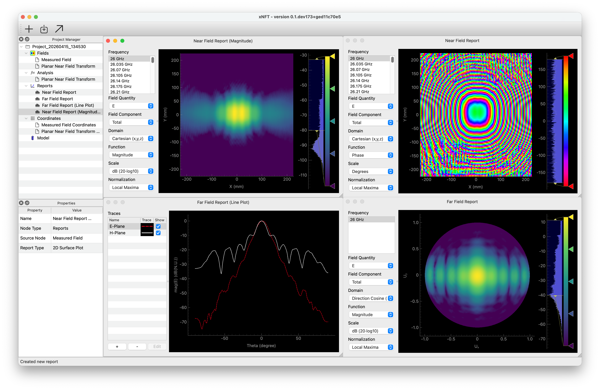

# LEmmA Near Field Measurement System

<!-- [](/../../releases) 
[
](/-/pipelines) -->

> [!CAUTION] ⚠️ xNFT is in active development (Alpha)
> xNFT is in active development. User interfaces and APIs may change frequently. For the most stable operation, use the latest release. For the most up-to-date features and bug fixes, consider building from source. 



# Installation

## Latest Release 

[](/../../releases)

The simplest method to use xNFT is to install the lasted packaged release for Windows or macOS from the [releases page](/../../releases).

## From Source 

For the latest features and bug fixes, install from source.

> [!NOTE] 
> The development environment uses the Pixi package manager (https://pixi.prefix.dev/latest/) and git (https://git-scm.com) to manage the envrionment and source code. It may be helpful to have a basic understanding of Pixi and git to install and use this software.

> [!WARNING] 
> Installing from the `main` branch may be unstable.  For the most stable operation, install the latest release.

<details>
<summary>
<h3>Prerequisites</h3> (Click to view)
</summary>

1. Install Pixi package manager by following the steps at: https://pixi.prefix.dev/latest/installation/
2. Install `git`. This may be installed via the OS package manager or pixi. Choose **_one_** option below: 
    - **Pixi (Any System):** in a terminal/PowerShell run:
        ```sh
        pixi global install --environment git --expose git git-lfs
        ```
        This will add the `git` and `git-lfs` executables to a global directory (typically in your home folder) and add the `git` executable to your terminal's search path.
    - **Winget (Windows):** In any "PowerShell" run:
        ```PowerShell
        winget install --id Git.Git -e --source winget
        ```
    - **Homebrew (macOS):** In terminal install via xcode-select or [Homebrew](https://brew.sh):
        ```sh
        xcode-select --install
        # or
        brew install git
        ```
    - **APT (Ubuntu):** In terminal install via apt:
        ```sh
        apt install git
        ```
</details>

### Download

1. Open a terminal/PowerShell and navigate to the location where you would like to download the project
2. Clone this repository via: 
    ```sh
    git clone https://gitlab.msu.edu/ece-lemma/xnft.git
    ```


### Install and Run

To quickly install the environment to run xNFT, run: 
```shell
pixi run xnft
```
This will install all packages necessary into the `default` Pixi environment, then run xNFT in the environment.
> [!NOTE]
> On the first run of `xnft` it may take some time to open as packages are compiled to Python bytecode. These compiled packages will be cached and it will open and run much faster on subsequent launches.

**Download Test Data (Optional)**

Optional test data (stored in git LFS) in the `tests/data/...` and `analysis/data/...` folders may be downloaded using `git lfs`. Note that these archives contain sevaral gigabytes of data and are thus not downloaded by default. The default pixi environment includes `git-lfs` so you can run
```sh
git lfs pull
```
to pull the remaining test datasets.

### Updating

If no uncommitted changes have been made to tracked files, simply update the source once it's been downloaded, simply run:
```sh
git pull
```

If any changes to tracked files have been made to your local copy, you may need to commit your changes or stash and reapply these changes to successfully pull and merge in the new upstream changes, e.g.:
```sh
git stash        # Pushes local changes onto the stash stack and resets the local working tree to last commit HEAD
git pull         # Pulls upstream changes and applies to local working tree moving the local HEAD to the same point as the remote
git stash apply  # Pops changes from the top of the stash stack and applies to the local working tree
```


### Running Jupyter Notebooks (Optional)

> [!CAUTION] Notice:
> Jupyter notebooks and analysis will be moved into separate repositories in future updates.

Jupter notebooks are included in the `notebooks` and `analysis` folders.  The `notebooks` folder contains examles of using the xNFT API to load, and perform computation using the Python API, and plot the results using Matplotlib.  The `analysis` folder contains notebooks containing error various analysis scripts.

#### Installation

To run the Jupter notebooks included with this project, a `jupter` pixi environment is provided.
1. [Recommended] Install Microsoft Visual Studio Code (VS Code): https://code.visualstudio.com
3. Install the `default` Pixi environment by running: 
    ```shell
    pixi install -e jupyter
    ```
    > [!NOTE] 
    > This command may be run from any terminal.  To use the built-in terminal in VS Code, drag up from the bottom of the VS Code window, or select "Terminal > New Terminal" from the file menu.
4. [If using VS Code] install the "Workspace Extensions" from the extensions tab on the menu bar on the left side of the screen (four blocks icon):
    - Python
    - Jupyter

#### Running

1. Open the desired Jupyter notebook `.ipynb` file from the `notebooks` or `analysis` folders
2. In the upper-right corner, press "Select Kernel"'
3. At the top of the screen select "Python Environments..." then select:
    ```
    Python 3.xx.x `.../xnft/.pixi/envs/jupyter/bin/python
    ```
    If it does not appear, you may need to choose "Browse..." and navigate to the python executable in the `.pixi` folder as shown above.
4. Press "Run All" from the tool bar at the top of the window to run the notebook


## Development

TODO...

### API Documentation

#### Pre-built docs

The latest automated docs build can be downloaded here: [**Download Latest Documentation**](https://gitlab.msu.edu/api/v4/projects/28094/jobs/artifacts/main/download?job=docs-build-job)

Once downloaded, unzip the archive and navigate to **`build/html/index.html`** to access the documentation.

### Upgrading Dependencies

> [!warning] 
> Upgrading all dependencies may break software due to incompatible changes in newer versions of libraries.

To upgrade dependencies listed in the `pyproject.toml` using pixi, run 
```shell
pixi upgrade <packages>
```
Omitting the `<packages>` will upgrade _all_ packages.  It may be useful to first run this using the `--dry-run` flag to only print the packages which will be upgraded prior to actually commiting the changes to the file.
