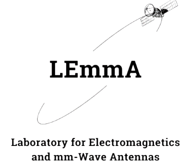
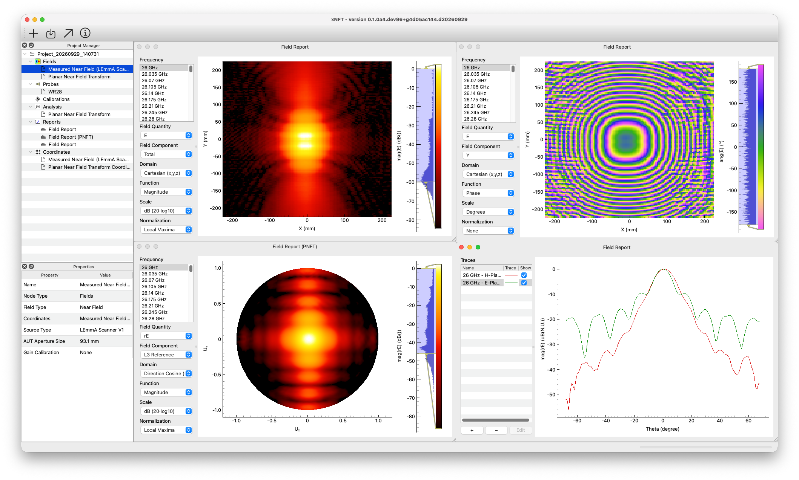

# _xNFT_: An Open Near-Field Antenna Measurement Software Suite

> [!CAUTION] ⚠️ xNFT is in active development (Beta)
> _xNFT_ is in active development. In beta, user interfaces and APIs may continue to change. For the most stable operation, use the latest tagged release. For the most up-to-date features and bug fixes, consider using `main` branch.

| | |
| ------ | ------ |
| Testing | [](../../pipelines)  |
| Package | [](/../../releases) |
| Meta |  |



## What is _xNFT_?

**_xNFT_** is a cross-platform, high-performance, general purpose antenna measurement and analysis software tool, primarily focusing on **near-to-far field transformations (NFTs)**, permissively distributed under the **MIT license**.  


> Screenshot of _xNFT_ running on macOS.  Measurements show an NSI-MI ANT-SGH-26.5-40 standard gain horn at 40 GHz collected using the LEmmA planar near-field scanner.

## Table of Contents

1. [Highlights](#highlights)
2. [System Requirements](#system-requirements)
3. [Installation](#installation)
4. [Documentation](#documentation)
5. [Dependencies](#dependencies)
6. [Known Issues](#known-issues)
7. [Contributing](#contributing)
8. [Citing _xNFT_](#citing-xnft)
9. [License](#license)
10. [Acknowledgements](#acknowledgements)

## Highlights

Some of the main features currently available in _xNFT_ are:

- **Planar near-to-far field transforms (PNFT).** _xNFT_ uses the [FINUFFT](https://finufft.readthedocs.io/en/latest/) library to compute the PNFT, enabling fast and accurate transforms from uniform and nonuniform* sampled source grids directly into uniformly sampled spherical coordinates.  
- **Probe Compensation.** Ideal open-ended waveguide measurement probe correction options are built into _xNFT_.
- **Graphical user interface (GUI).** _xNFT_ provides a rich GUI (via [Qt/PySide6](https://doc.qt.io/qtforpython-6/)) designed to look like common professional engineering tools with interactive plotting (via [PyQtGraph](https://www.pyqtgraph.org)) and analysis tools.
- **Data exporting.** Exporting options are availble in `.h5` and `.csv` formats for imported fields (data conversion) and processed report results.  Images may be exported using the underlying PyQtGraph framework (via right-click menu).
- **Plugin framework.** _xNFT_ has an extensible plugin framework allowing users to create custom data loaders in separate python packages allowing users to separate internal tools from the general _xNFT_ framework.

*Nonuniform source sampling has not yet been validated.

### In Progress

- Spherical near-to-far field transform (SNFT)
- Expanded plugin package capabilities. E.g., custom _Analysis_ options and _Report_ options.

## System Requirements

_xNFT_ is designed to run on a wide range of operating systems and architectures.  A list of system configurations designed to be compatible is included below. Other configurations may work, but are not currently considered supported configurations.

### _xNFT_ Design System Compatability Matrix

| Operating System | Versions          | Architectures    |
| ---------------- | ----------------- | ---------------- |
| macOS            | >= 15.0 (Sequoia) | x86-64, arm-64   |
| Linux            | ——                | x86-64, aarch64  |
| Windows          | 10, 11            | x86-64, arm-64*  |

*Emulated x86 via [Prism](https://learn.microsoft.com/en-us/windows/arm/apps-on-arm-x86-emulation)

### Validated Configurations

<details>
<summary>(Click to view table)</summary>

| Operating System | Versions          | Architecture               |
| ---------------- | ----------------- | -------------------------- |
| macOS            | 26 (Tahoe)        | arm-64                     |
|                  | 27 (Golden Gate)  | arm-64                     |
| Linux            | Alma 8.10, Alma 9.6, Alma 9.8    | x86-64                     |
|                  | Ubuntu 26.04             | aarch64                    |
| Windows          | 11                | x86-64                     |
|                  | 11                | arm-64 (via [Prism](https://learn.microsoft.com/en-us/windows/arm/apps-on-arm-x86-emulation)) |
| Windows (WSL2)   | 11 (Ubuntu 24.04) | x86-64                     |

</details>

## Installation

### Conda

🚧 TODO

### From Source

For the latest features and bug fixes, install from source using Pixi.

> [!NOTE]
> The development environment uses the Pixi package manager (<https://pixi.prefix.dev/latest/>) and git (<https://git-scm.com>) to manage the envrionment and source code. It may be helpful to have a basic understanding of Pixi and git to install and use this software.

<details>
<summary>
<h3>Prerequisites</h3> (Click to view)
</summary>

1. Install Pixi package manager by following the steps at: <https://pixi.prefix.dev/latest/installation/>

   After installation, you may need to close and re-open your terminal to properly source the Pixi executable.  Verify the installation was successful by running:

   ```sh
   pixi --version
   ```

2. Install `git` and `git-lfs`. This may be installed via the OS package manager or pixi.

   Choose only **_one_** option below:
    - **Windows (Winget):** In any "PowerShell" run:

        ```PowerShell
        winget install --id Git.Git -e --source winget
        ```

    - **macOS or Linux (Pixi):** in a terminal run:

        ```sh
        pixi global install --environment git --expose git git-lfs
        ```

        This will add the `git` and `git-lfs` executables to a global directory (typically in your home folder) and add the `git` executable to your terminal's search path.

    - **macOS (Homebrew):** In terminal install via [Homebrew](https://brew.sh):

        ```sh
        brew install git git-lfs
        ```

    - **Ubuntu or Debian (APT):** In terminal install via apt:

        ```sh
        sudo apt update
        sudo apt install git git-lfs
        ```

3. Install git-lfs hooks:

    ```sh
    git lfs install
    ```

</details>

#### Download

1. Open a terminal/PowerShell and navigate to the location where you would like to download the project
2. Clone this repository by clicking the **Code** button in the upper right and selecting either "Clone with SSH" or "Clone with HTTPS" to copy the repo URL, then run:

    ```shell
    git clone <copied-url>
    ```

> [!Note]
> The SSH option will use your SSH keys allowing for more convenient passwordless authentication if your ssh-agent is properly configured.

#### Install and Run

To quickly install the environment to run _xNFT_, run:

```shell
pixi run xnft
```

This will install all packages necessary into the `default` Pixi environment, then run _xNFT_ in the environment.
> [!NOTE]
> On the first run of `xnft` it may take some time to open as packages are compiled to Python bytecode. These compiled packages will be cached and it will open and run much faster on subsequent launches.

#### Download Test Data (Optional)

Optional test data is stored in a secondary **[`xnft-data`](https://www.gitlab.msu.edu/ece-lemma/public/xnft/xnft-data)** repository included as a git submodule in this project.  Note that these archives contain sevaral gigabytes of data and are thus not downloaded by default.

To pull the datasets, run:

```sh
GIT_LFS_SKIP_SMUDGE=1 git submodule update --init --recursive
git submodule foreach --recursive "git lfs pull"
```

This will download datasets in to the `data/...` folders.

## Documentation

Documentation can be found in the **[docs folder](docs)**.

- The **[Getting Started](docs/getting_started.md)** tutorial and video is the best place to start.
- A more in depth **[User Guide](docs/user_guide.md)** is also available.

<!-- 
### Pre-built Docs

The latest automated docs build can be downloaded here: 

- [**PDF Documentation**](https://gitlab.msu.edu/api/v4/projects/28094/jobs/artifacts/main/raw/docs/build/xnft-docs.pdf?job=docs-build)
- [**HTML Documentation**](https://gitlab.msu.edu/api/v4/projects/28094/jobs/artifacts/main/raw/docs/build/xnft-docs.tar.gz?job=docs-build)

Once downloaded, unzip the archive and navigate to **`build/html/index.html`** to access the documentation.

### Local Docs Generation

To build all docs locally (PDF and HTML), run:

```shell
pixi run -e docs build-docs
```

Just the HTML docs or just the PDF docs may be built by running

```shell
pixi run -e docs build-html-docs
```

or 

```shell
pixi run -e docs build-pdf-docs
```
 -->

## Dependencies

🚧TODO

## Known Issues

A summary of the high-impact issues are included in the [Work Items](https://www.gitlab.msu.edu/ece-lemma/public/xnft/xnft/-/work_items?sort=created_date&state=opened&or%5Blabel_name%5D%5B%5D=Impact%3A%3AHigh&or%5Blabel_name%5D%5B%5D=Priority%3A%3ACritical&or%5Blabel_name%5D%5B%5D=Priority%3A%3AHigh&not%5Blabel_name%5D%5B%5D=docs&first_page_size=100).

## Contributing

If you find a bug or feature, please check if an issue exists in [Work Items](https://www.gitlab.msu.edu/ece-lemma/public/xnft/xnft/-/work_items). submit an issue in the .

Refer to [CONTRIBUTING](CONTRIBUTING.md) for further guidance.

## Citing _xNFT_

If you use _xNFT_ in your work, please consider citing it.

BibTex reference format:

```text
🚧 TODO
```

- Zendoo?
- .cff file?

## License

Copyright 2026 Michigan State University. All rights reserved.

The original source code for this project is distributed under the [MIT license](LICENSE).

This project depends on third-party libraries which are distributed separately and remain subject to their respective licenses.  For a complete list of runtime dependencies, see the `package.run-dependencies` section of the [`pixi.toml`](pixi.toml) file.

## Acknowledgements

This work was sponsored by the Air Force Research Laboratory (AFRL) under grant number FA87502510001. The views expressed are those of the authors and do not reflect the official policy or position of he Department of Defense or the U.S. Government
