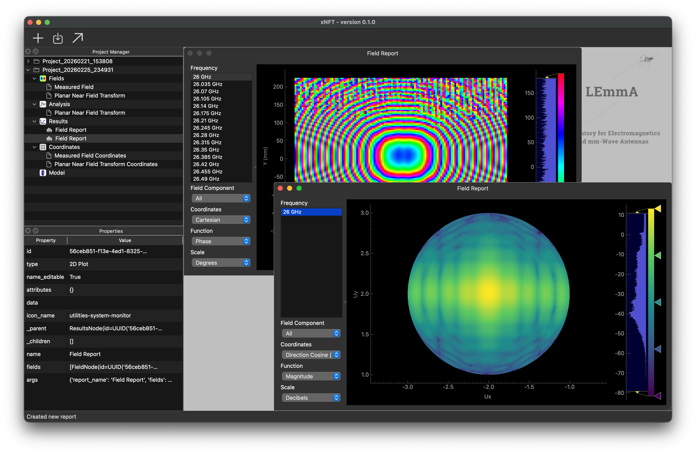

# LEmmA Near Field Measurement System



## Download and Installation

**Download**

<details>
<summary>Prerequisite: Install Git Source Code Management (SCM) [Click to expand]</summary>

- Windows: In any "PowerShell" run:
    ```PowerShell
    winget install --id Git.Git -e --source winget
    ```
- macOS: In terminal install via xcode-select or [Homebrew](https://brew.sh):
    ```sh
    xcode-select --install
    # or
    brew install git
    ```
- Ubuntu: In terminal install via apt:
    ```sh
    apt install git
    ```
- For more info see: https://git-scm.com
</details>

1. Open a terminal/PowerShell and navigate to the location where you would like to download the project
2. Clone this repository via: 
    ```sh
    git clone https://gitlab.msu.edu/ece-lemma/xnft.git
    ```

**Installation**

To quickly install the environment to run `xnft`, follow the steps below:

1. Install Pixi package manager: https://pixi.prefix.dev/latest/installation/
2. Launch `xnft` by running: 
    ```shell
    pixi run xnft
    ```
Step 2 will install all packages necessary then run `xnft` in the `default` environment.
> [!NOTE]
> On the first run of `xnft` it may take some time to open as packages are compiled. These compiled packages will be cached and it will open and run much faster on subsequent launches.

3. [Optional] Download test data (stored in git LFS). The default pixi environment includes `git-lfs` so you can run
    ```sh
    git lfs pull
    ```
    to pull the remaining test datasets.

### Running Jupyter Notebooks (Optional)

To run the Jupter notebooks included with this project, a `jupter` pixi environment is provided.
1. [Recommended] Install Microsoft Visual Studio Code (VS Code): https://code.visualstudio.com
2. Install Pixi package manager: https://pixi.prefix.dev/latest/installation/
3. Install the `default` Pixi environment by running: 
    ```shell
    pixi install -e jupyter
    ```
    > [!NOTE] 
    > This command may be run from any terminal.  To use the built-in terminal in VS Code, drag up from the bottom of the VS Code window, or select "Terminal > New Terminal" from the file menu.
4. [If using VS Code] install the "Workspace Extensions" from the extensions tab on the menu bar on the left side of the screen (four blocks icon):
    - Python
    - Jupyter

**Running**

1. Open the desired Jupyter notebook `.ipynb` file from the `Notebooks` folder
2. In the upper-right corner, press "Select Kernel"'
3. At the top of the screen select "Python Environments..." then select:
    ```
    Python 3.xx.x `.../xnft/.pixi/envs/jupyter/bin/python
    ```
    If it does not appear, you may need to choose "Browse..." and navigate to the python executable in the `.pixi` folder as shown above.
4. Press "Run All" from the tool bar at the top of the window to run the notebook


## Development

TODO...

### Upgrading Dependencies

> [!warning] 
> Upgrading all dependencies may break software due to incompatible changes in newer versions of libraries.

To upgrade dependencies listed in the `pyproject.toml` using pixi, run 
```shell
pixi upgrade <packages>
```
Omitting the `<packages>` will upgrade _all_ packages.  It may be useful to first run this using the `--dry-run` flag to only print the packages which will be upgraded prior to actually commiting the changes to the file.
