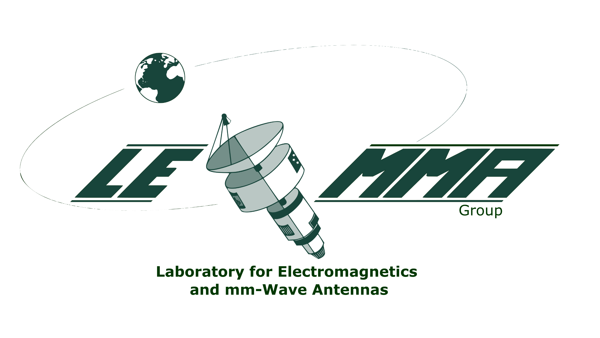

# _xNFT_: An Open Near-Field Antenna Measurement Software Suite

<table>
  <tr>
    <td><a></a></td>
    <td><a href="https://sites.google.com/site/mauroettorre/home"></a></td>
    <td><a href="https://www.egr.msu.edu/emrg/"></a></td>
  </tr>
</table>

| | |
| ------ | ------ |
| Testing | [](../../pipelines)  |
| Package | [](/../../releases)   |
| Meta | [](LICENSE) |

> [!WARNING] 
> ⚠️ **_xNFT_ is in active development (Beta).**
> User interfaces and APIs may continue to change.

> [!NOTE]
> The primary source for xNFT is the **[MSU GitLab repository](https://www.gitlab.msu.edu/ece-lemma/public/xnft/xnft)**.
> 
> Community contributions are welcomed via the **[GitHub Mirror](https://github.com/msu-lemma/xnft)**. Issues and pull requests may be submitted to this location for discussion.

## What is _xNFT_?

**_xNFT_** is a cross-platform, high-performance, general purpose antenna measurement and analysis software tool, primarily focusing on **near-to-far field transformations (NFTs)**, permissively distributed under the **MIT license**.  

Check out our **[Video Demo](https://youtu.be/SiD9lgWeYf4?t=24)** to see some of _xNFT_'s features in action!


> Screenshot of _xNFT_ running on macOS.  Measurements show an NSI-MI ANT-SGH-26.5-40 standard gain horn at 26.5 GHz collected using the LEmmA planar near-field scanner.

## Table of Contents

1. [Highlights](#highlights)
2. [System Requirements](#system-requirements)
3. [Installation](#installation)
4. [Documentation](#documentation)
5. [Known Issues](#known-issues)
6. [Contributing](#contributing)
7. [Citing _xNFT_](#citing-xnft)
8. [License](#license)
9. [Acknowledgements](#acknowledgements)

## Highlights

Some of the main features currently available in _xNFT_ are:

- **Planar near-to-far field transforms (PNFT).** _xNFT_ uses the [FINUFFT](https://finufft.readthedocs.io/en/latest/) library to compute the PNFT, enabling fast and accurate transforms from uniform and nonuniform* sampled source grids directly into uniformly sampled spherical coordinates.  
- **Probe Compensation.** Ideal open-ended waveguide measurement probe correction options are built into _xNFT_.
- **Gain Calibration.** Gain calibration may be performed using the gain transfer method via a calibrated measurement antenna and gain reference table in `.csv` or `.ngt` format.
- **Graphical user interface (GUI).** _xNFT_ provides a rich GUI (via [Qt/PySide6](https://doc.qt.io/qtforpython-6/)) designed to look like common professional engineering tools with interactive plotting (via [PyQtGraph](https://www.pyqtgraph.org)) and analysis tools.
- **Data exporting.** Exporting options are availble in `.h5` and `.csv` formats for imported fields (data conversion) and processed report results.  Images may be exported using the underlying PyQtGraph framework (via right-click menu).
- **Plugin framework.** _xNFT_ has an extensible plugin framework allowing users to create custom data loaders in separate python packages allowing users to separate internal tools from the general _xNFT_ framework. For more information see the [_xNFT_ Plugin Example repository](https://www.gitlab.msu.edu/ece-lemma/public/xnft/xnft-example).

*Nonuniform source sampling has not yet been validated.

### In Progress

- Spherical near-to-far field transform (SNFT)
- Expanded plugin package capabilities. E.g., custom _Analysis_ options and _Report_ options.

## System Requirements

_xNFT_ is designed to run on a wide range of operating systems and architectures.  A list of system configurations designed to be compatible is included below. Other configurations may work, but are not currently considered supported configurations.

### _xNFT_ Design System Compatability Matrix

| Operating System | Versions          | Architectures    |
| ---------------- | ----------------- | ---------------- |
| macOS            | >= 15.0 (Sequoia) | x86-64, arm-64   |
| Linux            | ——                | x86-64, aarch64  |
| Windows          | 10, 11            | x86-64, arm-64*  |

*Emulated x86 via [Prism](https://learn.microsoft.com/en-us/windows/arm/apps-on-arm-x86-emulation)

### Validated Configurations

<details>
<summary>(Click to view table)</summary>

| Operating System | Versions          | Architecture               |
| ---------------- | ----------------- | -------------------------- |
| macOS            | 26 (Tahoe)        | arm-64                     |
|                  | 27 (Golden Gate)  | arm-64                     |
| Linux            | Alma 8.10, Alma 9.6, Alma 9.8    | x86-64                     |
|                  | Ubuntu 26.04             | x86-64                    |
|                  | Ubuntu 26.04             | aarch64*                     |
| Windows          | 11                | x86-64                     |
|                  | 11                | arm-64 (via [Prism](https://learn.microsoft.com/en-us/windows/arm/apps-on-arm-x86-emulation)) |
| Windows (WSL2)   | 11 (Ubuntu 24.04) | x86-64                     |

*Install from source using Pixi

</details>

## Installation

To install _xNFT_ run:

```shell
uv tool install xnft
```

For futher install information and to download test data, see **[Installing _xNFT_](docs/installing.md)**.

## Documentation

Documentation can be found in the **[docs folder](docs)**.

- **[Installation](docs/installing.md):** Instructions for installing and packaging _xNFT_, and downloading test data.
- **[Getting Started](docs/getting_started.md)**: A quick-start guide including a written tutorial and usage video.
- **[User Guide](docs/user_guide.md)**: Documentation of user interface and antenna analysis workflow.

### Developer Documentation

There is a minimal API documentation generated by Sphinx from the docstrings.  This is built by the CI task available at:

- [**PDF Documentation**](https://gitlab.msu.edu/api/v4/projects/28094/jobs/artifacts/main/raw/docs/api/build/xnft-docs.pdf?job=docs-build)
- [**HTML Documentation**](https://gitlab.msu.edu/api/v4/projects/28094/jobs/artifacts/main/raw/docs/api/build/xnft-docs.tar.gz?job=docs-build)

<details>
<summary>
<h4>Local API Documentation Generation</h4> (Click to view)
</summary>

To build all docs locally (PDF and HTML), run:

```shell
pixi run -e docs build-docs
```

Just the HTML docs or just the PDF docs may be built by running

```shell
pixi run -e docs build-html-docs
```

or

```shell
pixi run -e docs build-pdf-docs
```

</details>

## Known Issues

A summary of the high-impact issues are included in the [Work Items](https://www.gitlab.msu.edu/ece-lemma/public/xnft/xnft/-/work_items/views/43).

## Contributing

Community contributions in the form of bug reports, feature requests, and pull requests are welcome!

If you find a bug or would like to request a feature, please first check if a similar issue already exists in [Work Items](https://www.gitlab.msu.edu/ece-lemma/public/xnft/xnft/-/work_items) or the [GitHub Issues](https://github.com/msu-lemma/xnft/issues).  If not, please [open an issue on the GitHub project](https://github.com/msu-lemma/xnft/issues).

Please refer to [CONTRIBUTING](CONTRIBUTING.md) for further guidance.

## Citing _xNFT_

If you use _xNFT_ in your work, please consider citing it. Citation metadata is available in the **[CFF reference file](CITATION.cff)**.

- **When citing the use of the software package**, please specify the version used for reproduceability.  The preferred format is:

  <!-- > J. M. Merlo and M. Ettorre. *xNFT - Antenna measurement software.* (v#.#.#). Michigan State University. [Online]. Available: https://www.gitlab.msu.edu/ece-lemma/public/xnft/xnft -->

  > J. M. Merlo, M. Ettorre. *xNFT: An Open Near-Field Antenna Measurement Software Suite.* (v#.#.#). Zenodo. doi: 10.5281/zenodo.23693994.

  <!-- <details>
  <summary>BibTex Format (click to view)</summary>

  🚧 TODO 🚧

  ```text
  @software{xnft,
    author={Merlo, Jason M. and Ettorre, Mauro},
    title={{xNFT} - {A}ntenna measurement software},
    month={November},
    year={2026},
    version={v0.1.0}, 
    keywords={Antenna measurements, near-field measurement, near-field transform, open-source software, probe compensation},
    doi={},
    publisher={Michigan State University},
    url={https://www.gitlab.msu.edu/ece-lemma/public/xnft/xnft}}
  ```

  </details>
-->
    Please replace "(v#.#.#)" with the version of the software you used, e.g. "(v0.1.0)" and the DOI with the appropriate DOI for the relase [on Zenodo](https://doi.org/10.5281/zenodo.23693993).

- **When citing the software package implementation**, please cite our AMTA conference paper. The preferred format is:

  > J. M. Merlo and M. Ettorre., "xNFT: An open near-field antenna measurement software suite," 2026 Antenna Measurement Techniques Association Symposium (AMTA), Austin, TX, USA, 2026.

  <details>
  <summary>BibTex Format (click to view)</summary>

  ```text
  @inproceedings{xnft2026amta,
    author={Merlo, Jason M. and Ettorre, Mauro},
    booktitle={2026 Antenna Measurement Techniques Association Symposium (AMTA)}, 
    title={xNFT: An Open Near-Field Antenna Measurement Software Suite}, 
    year={2026},
    pages={1-6},
    keywords={Antenna measurements, near-field measurement, near-field transform, open-source software, probe compensation},
    doi={}}
  ```

  </details>

## License

Copyright ©️ 2026 Michigan State University. All rights reserved.

The original source code for this project is distributed under the [MIT license](LICENSE).

This project depends on third-party libraries which are distributed separately and remain subject to their respective licenses.  For a complete list of runtime dependencies, see the `workspace.dependencies` section of the [`pixi.toml`](pixi.toml#L13) file.

## Acknowledgements

This work was sponsored by the Air Force Research Laboratory (AFRL) under grant number FA87502510001. The views expressed are those of the authors and do not reflect the official policy or position of the Department of Defense or the U.S. Government.
