# Getting Started

This quick start provides a walk-through demonstrating how to load example measured data of a standard gain horn antenna from the LEmmA scanner, perform a planar near-to-far field transform with probe corrections, and plot the results. A video and written instructions are provided.

## Quick Start Video
[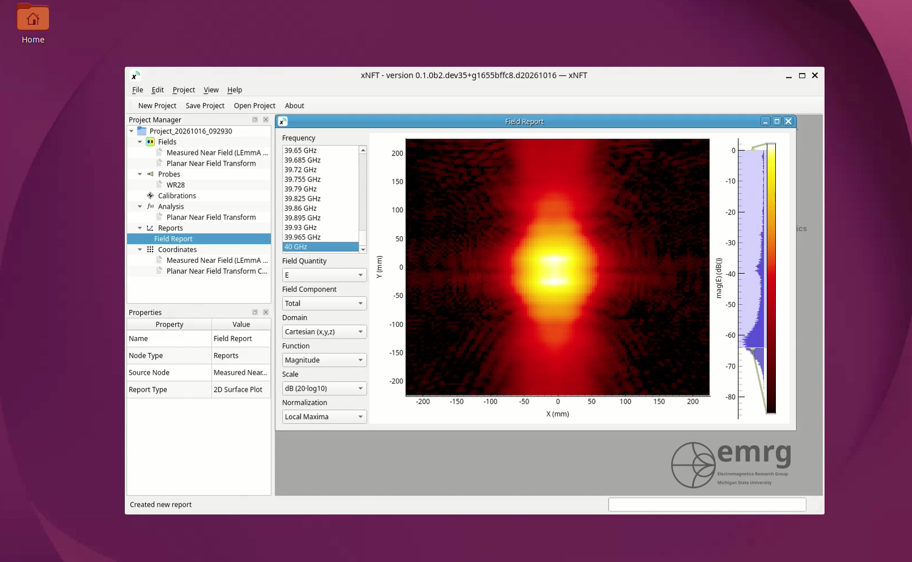](https://mediaspace.msu.edu/media/xNFT+Quick+Start/1_varqfks0)

> Click the video icon above to view the video at [https://mediaspace.msu.edu/media/xNFT+Quick+Start/1_varqfks0](https://mediaspace.msu.edu/media/xNFT+Quick+Start/1_varqfks0).

## Quick Start Instructions

### 1. Installation

To install _xNFT_ and download test data, see **[Installing _xNFT_](docs/installing.md)**.

> [!NOTE]
> Be sure to **[download the test data](installing.md#2-download-test-data-optional)** during installation.

### 2. Run _xNFT_

After installation the _xNFT_ application should be included in the `PATH` and should be executable simply typing `xnft` in the terminal.  

>[!NOTE]
> If an environment manager such as virtualenv, conda, pixi, etc. was used, be sure to activate that environment first.

Once _xNFT_ starts, a window similar the window below should open.

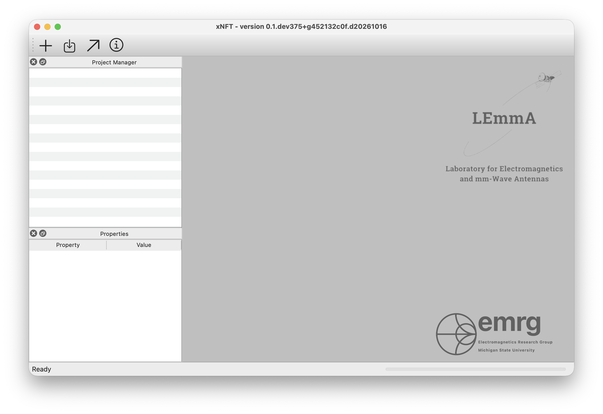

> Fig. 1.  New _xNFT_ Window.

The user interface (UI) elements are annotated in the picture below. These names will be used to refer to the various section of the UI throughout this tutorial.

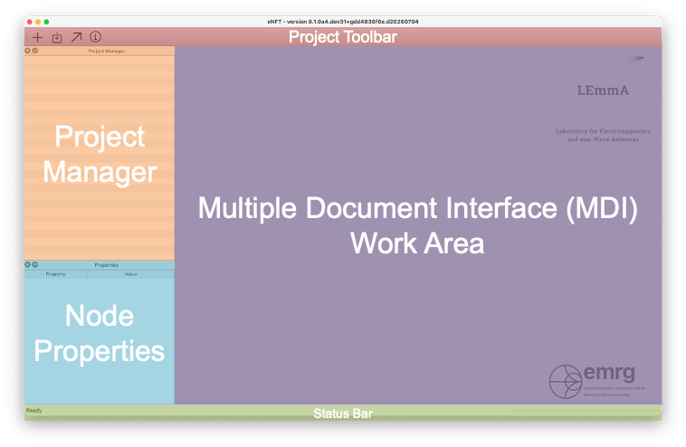

> Fig. 2.  _xNFT_ user interface overview.

### 3. Create a new Project

To create a new Project select the new project <kbd>+</kbd> icon in the Project Toolbar at the top of the screen (icon may vary by operating system).

This will present you with a New Project dialog prompting a project name and directory to save the project to, shown below.

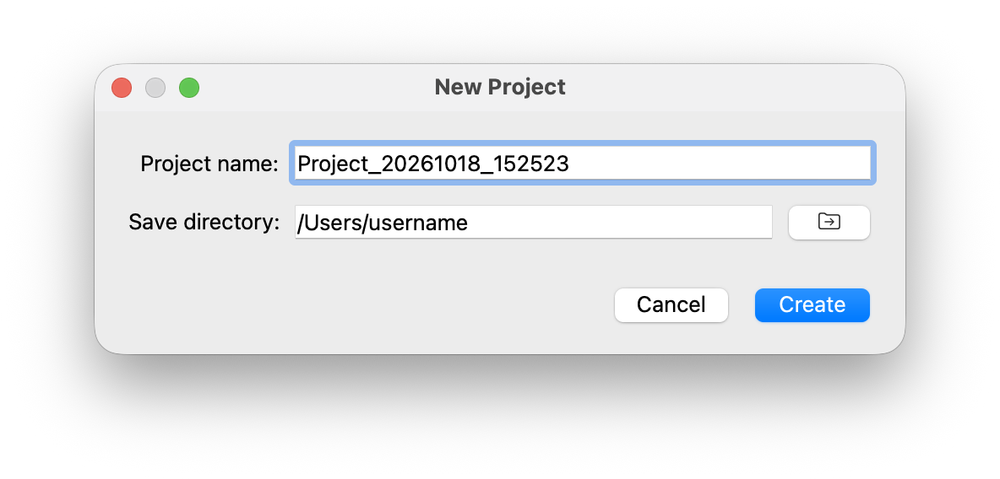

> Fig. 3.  New Project dialog.

> [!NOTE]
> Currently thre is no "Save As" so the project path cannot be changed through _xNFT_ after this step.

> [!CAUTION]
> The `.xnft` project file is not yet stable between versions.  A project saved in one version of _xNFT_ may not be compatible with older or newer versions of the software.
>
> This is a high priority issue and a stable file format is being actively developed.

After a new project is created the Project Manager is populated with the root Project Node and the default Nodes: Fields, Probes, Calibrations, Analysis, Reports, and Coordinates.  See **[Project Manager](user_guide.md#project-manager)** in the User Guide for further descriptions of each of the ndoes.

### 4. Import measured Fields

Presently, all project operations can be completed by right-clicking on a project Node.

Right-click on the Field Node to add a new measured field.  A New Field Measurement dialog will appear.

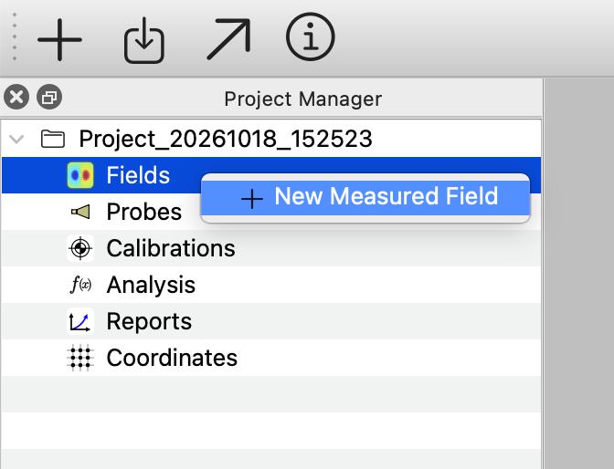

> Fig. 4. New measured field.

In the New Field Measurement dialog, the user may enter the desired Field Name or accept the automatically generated name based on the source file format.

For this demonstration, select the "LEmmA Scanner V1" file format.  We will load the NSI-MI ANT-SGH-26.5-40 standard gain horn antenna measurement from the LEmmA planar near-field scanner.  To load this, navigate to `/Users/merlojas/Projects/lemma/xnft/data/near_field/planar/xnft.lemma_v1/` and select:

- `003_nsi_ant-sgh-26_5-40_20260210_1453_co.h5`
- `003_nsi_ant-sgh-26_5-40_20260210_1453_cx.h5`

for the co-pol and cross-pol fields respectively.

For the AUT aperture size, enter `93.1 mm`. This is the largest extent of the AUT aperture--for a rectangular aperture this would be the diagonal.  This size, in conjunction with the distance between the AUT and probe, will determine the valid field of view (FoV) of the far-field results.  The distance between AUT and probe is embedded into the measurement file.

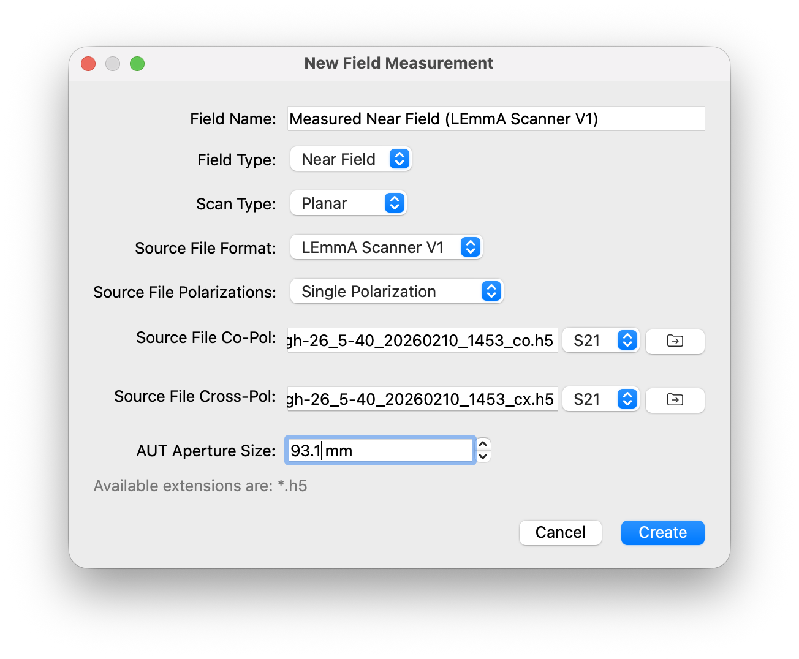

> Fig. 5. New Field Measurement dialog.

### 5. Add a measurement probe

To apply probe corrections, a probe must be added to the project.  This can be performed by right-clicking on the Probes node and selecting "New Measurement Probe".

A dialog will appear where the user can select a standard probe size or enter custom probe dimensions.

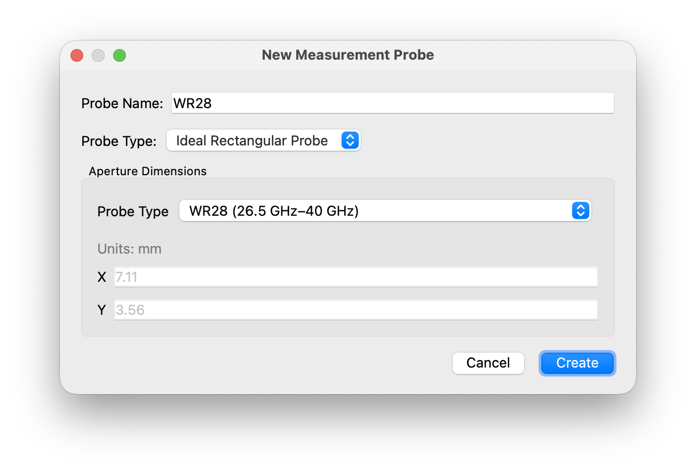

> Fig. 6. New Measurement Probe dialog.

> [!NOTE]
> Currently only the "Ideal Rectangular Probe" format is available, which uses the analytic pattern for an ideal open-ended waveguide, but support for measured probe files is planned in future versions of _xNFT_.

### 6. Perform a planar near-to-far field transform

To perform a planar near-to-far field transform (PNFT), right click on the Analysis Node and select "New Planar Near-To-Far Field Transform".  A dialog will appear where you can provide a name, select the desired source field, the desired frequencies to perform the transform at, the probe corrections to use, and if a gain calibration should be applied.  

To select multiple individual frequencies, <kbd>ctrl</kbd> (or <kbd>⌘</kbd> on macOS), or hold <kbd>shift</kbd> to select a range of frequencies.  To select all frequencies press  <kbd>ctrl-A</kbd> (or <kbd>⌘-A</kbd> on macOS).

The probe corrections for our probe are applied by default.  To skip probe corrections, select None from the dropdown.

Finally, if a gain calibration is performed with a reference horn, a gain calibration can be applied; however, we will not use one in this example.

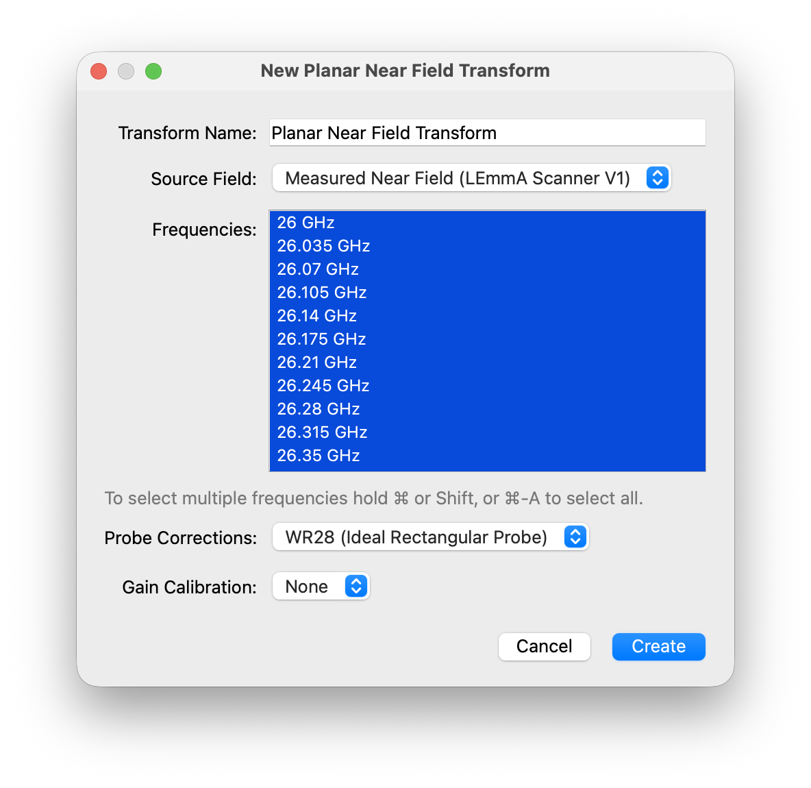

> Fig. 7. New Measurement Probe dialog.

The PNFT may take a few moments to complete.  A busy indicator is shown along the bottom of the window in the Status Bar to indicate the operation is still running.  Once completed, a new Node will appear "Analysis" in the Project Manager.  Selecting the new node will display its attributes in the Node Properties panel, shown below.

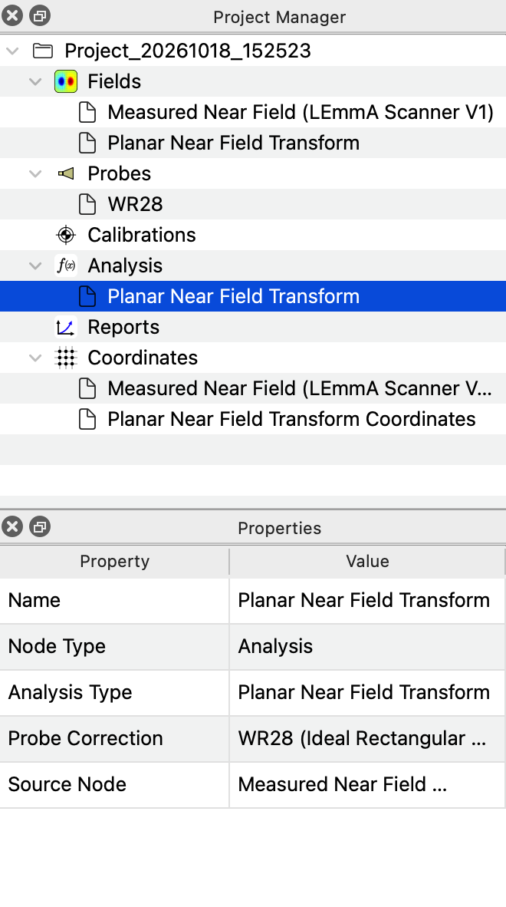

> Fig. 8. PNFT node properties.

### 8. Generate reports

Currently the supported report types are Line Plot and Surface Plot.  We will start by generating Surface Plots for the near- and far-field data.

#### 8.1. Surface Plots

A Surface Plot can be generated by right-clicking on the Reports node and selecting "New Surface Plot".  In the "New Field Report" dialog, select the desired field to display.  Examples for the near- and far-field data are shown below.

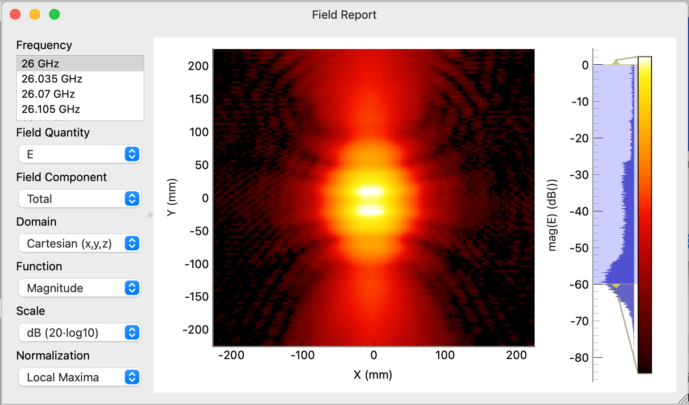

> Fig. 8. Near-Field Surface Plot.

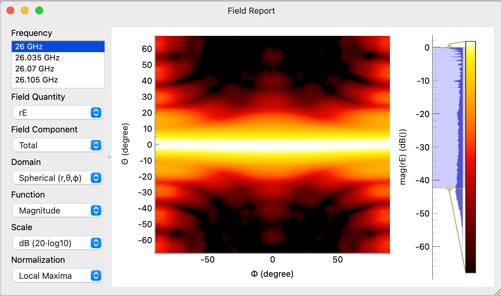

> Fig. 9. Far-Field Surface Plot.

The Surface Plot control pane on the left side of the viewer displays the frequency selection as well as Field Quantity, Field Component, Domain, Function, Scale, and Normalization.  Values will differ based on near-field or far-field measurements. On the right side an interactive slider is available to adjust the dynamic range thresholds.

Below is an example of the same far-field data viewing the Ludwig-3 Reference field quantity in directional cosine space visualizing the phase component.

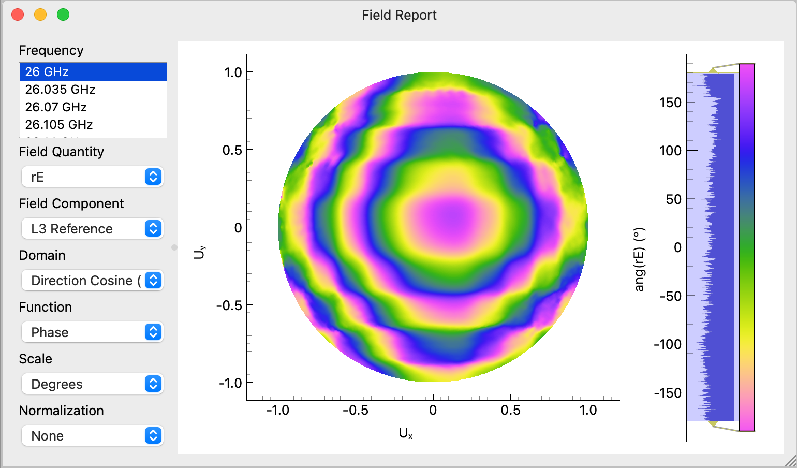

> Fig. 10. Far-Field Surface Plot showing phase in the directional cosine space.

For furhter information, see the **[Surface Plot](user_guide.md#surface-plot)** and **[Plotting Parameters and Functions](user_guide.md#common-plotting-parametersfunctions)** sections in the User Guide.

#### 8.2. Line Plots

A Line Plot can be generated by right-clicking on the Reports node and selecting "New Line Plot".  This will prompt the user for a name.  Once the new Line Plot is created a blank Line Plot window will appear, shown below.

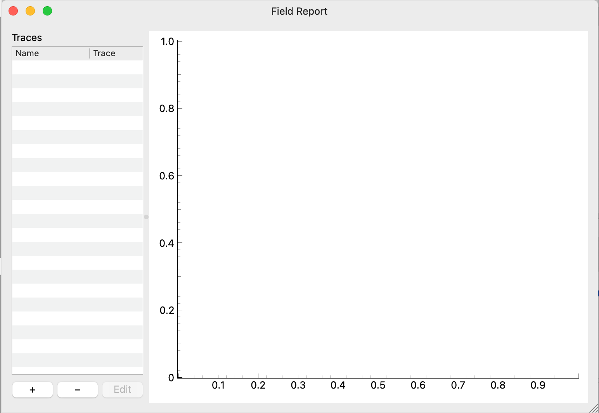

> Fig. 11. New empty Line Plot window.

A new trace or traces can be added to the Line Plot by selecting the <kbd>+</kbd> button in the lower-left corner of the control panel.  This will present the user with a New Trace dialog, shown below.

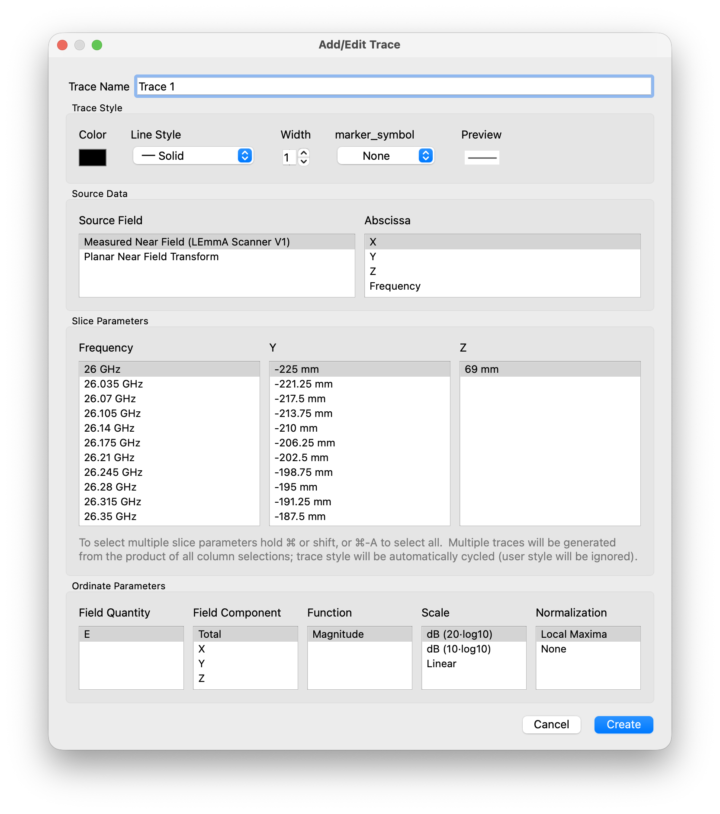

> Fig. 12. New Trace dialog.

A new trace name may be provided (this can be changed later in the "Traces" list of the control panel).  In addition there are fields for Source Field, Abscissa, Slice Parameters, and Orginate Parameters.

Multiple slice parameters can be selected at once to quickly produce multiple traces by selecting <kbd>ctrl</kbd> (or <kbd>⌘</kbd> on macOS), or holding <kbd>shift</kbd> to select a range of parameters.  To select all slice parameters in a column press  <kbd>ctrl-A</kbd> (or <kbd>⌘-A</kbd> on macOS).

We will plot the far-field data (Planar Near Field Transform) with Theta on the Abscissa for frequency 40 GHz and Phi angles of 0° and 90°.  This can be accomplished by holding <kbd>ctrl</kbd> (or <kbd>⌘</kbd> on macOS) in the Phi column.

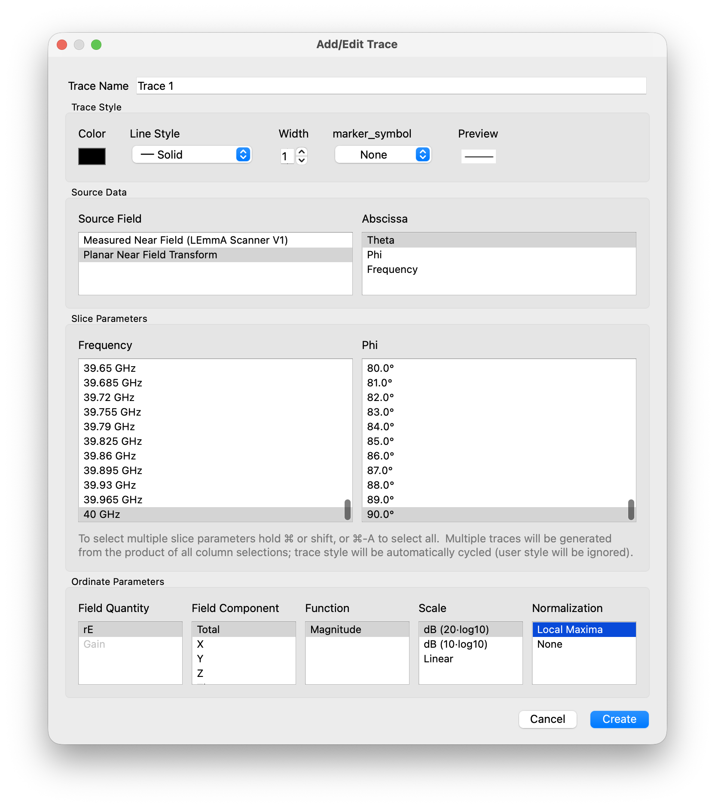

> Fig. 13. New Trace dialog with our parameters selected.

This will produce a plot with our two slices selected, in order, e.g., Phi=0° and Phi=90°.  

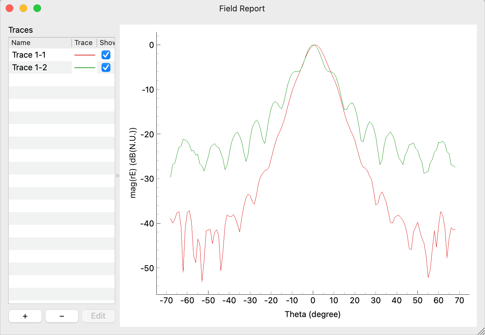

> Fig. 14. Line Plot with selected data.

These traces may be renamed by double-clicking on their names and entering new values, shown below.

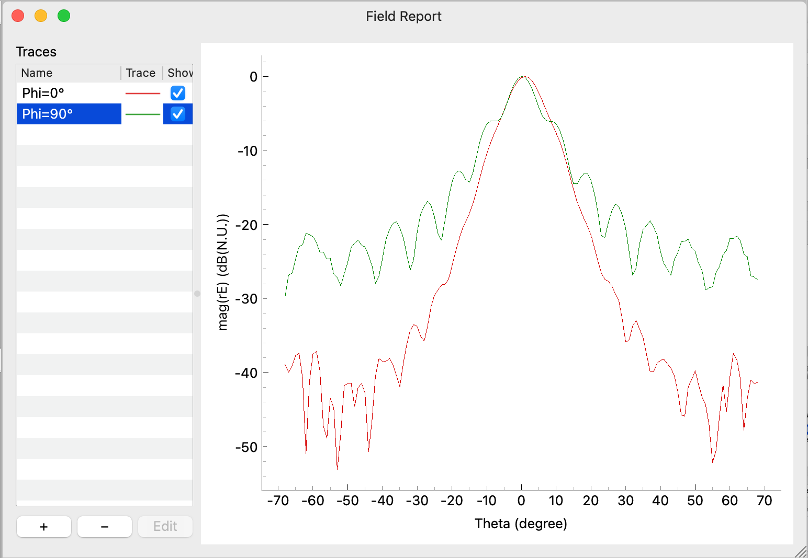

> Fig. 15. Line Plot with renamed traces.

Line Plot traces may be removed by pressing the <kbd>–</kbd> button at the bottom left in the control panel.

For furhter information on Line Plots, see the **[Line Plot](user_guide.md#line-plot)** section of the User Guide.
