# Getting Started

## User Interface Overview

The main xNFT window, shown in Fig. 1, is structured to be similar to other engineering design software.

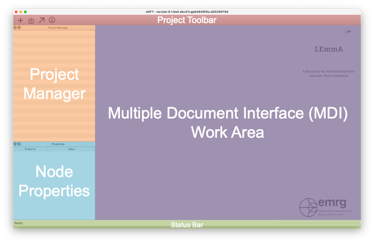

> **Fig. 1.**  xNFT main window.

The main window is separated into five areas:

- **Project Toolbar**: contains high-level actions such as _New Project_, _Save Project_, and _Load Project_.  
- **Project Manager**: displays project _Nodes_ containing data, transforms, reports, etc. 
- **Node Properties**: displays additional attributes of the selected project node in the _Project Manager_.
- **Work Area**: allows the viewing of multiple reports/plots contained within the main window.
- **Status Bar**: displays current, or recently completed, project action in the lower-left; displays progress/busy indicator bar in the lower right for long-running tasks.

> [!NOTE]
> The _Project Manager_, _Node Properties_, and _Project Toolbar_ are dockable widgets that can be relocated or removed.  If removed, they may be re-added from the _View_ menu.

## Project Manager

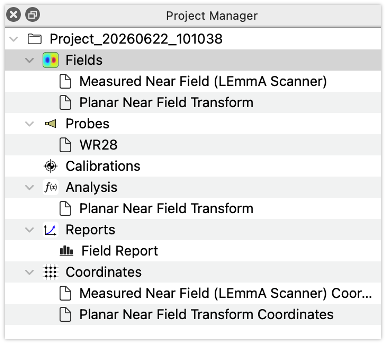

> **Fig. 2:** Project manager view of a typical project.

The _Project Manager_ is the primary method of interaction for working with a project.  It may contain multiple open projects and their nodes. Each project contains six nodes on creation:

- **Fields**: Contains all user imported and derived fields for the project. This may include imported fields from a scanner of computational EM software, or fields derived by xNFT through a near-field transoform.
- **Probes**: Contains all measurement probes used in the project; used for probe corrections.
- **Calibrations**: Contains gain calibration nodes.
- **Analysis**: Contains xNFT analysis functions such as near-field transform information.
- **Reports**: Contains all user-generated reports (primarily plots).
- **Coordinates**: Contains all coordinate systems used in the project.  The _Node Properties_ of _Fields Nodes_ will display the _Coordidnates_ they use.

By right-clicking on a _Node_ an additional list of actions is presented.

### Project Node

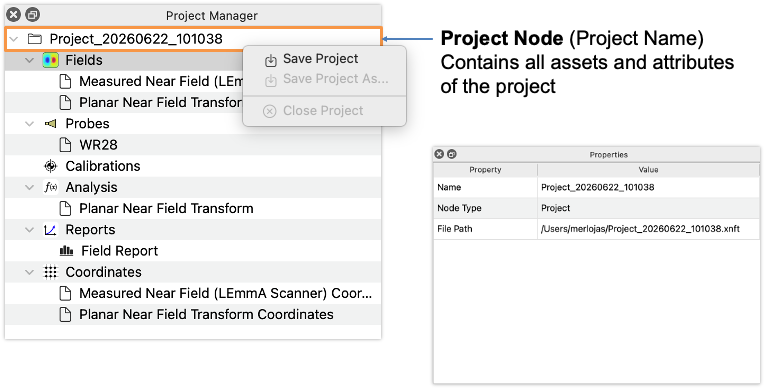
> **Fig. 3:** Project node.

### Fields Node

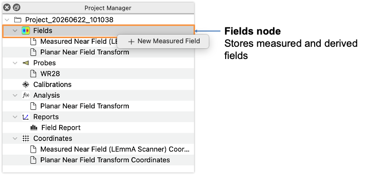
> **Fig. 4:** Fields node.

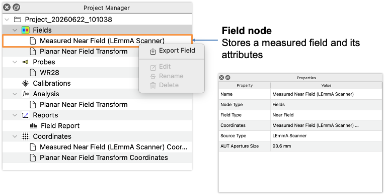
> **Fig. 5:** Field node.

### Exporting Fields Data

The _Field Node_  provides the functionality to export field data to HDF5 `.h5` and CSV `.csv` for convenience.  The export dialog may be accessed by right-clicking on a _Field Node_.

> [!NOTE]
> It's _strongly_ encouraged to use HDF5 `.h5` for exporting field data.  Writing fields to CSV `.csv` files can create very large files (100's of megabytes) which are slow to read and write and may result in loss of numerical precision.

### Probes Node

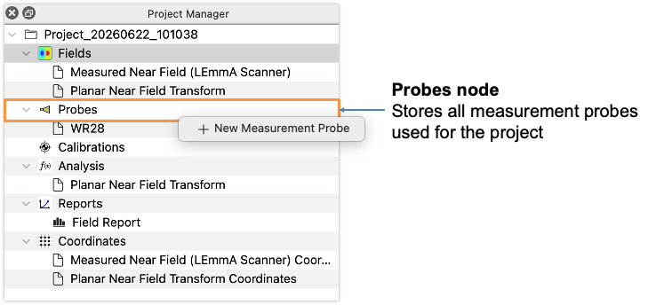
> **Fig. 6:** Probes node.

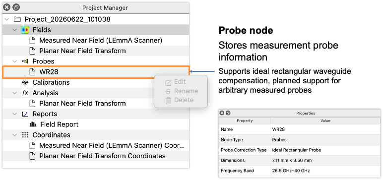
> **Fig. 7:** Probe node.

### Calibrations Node

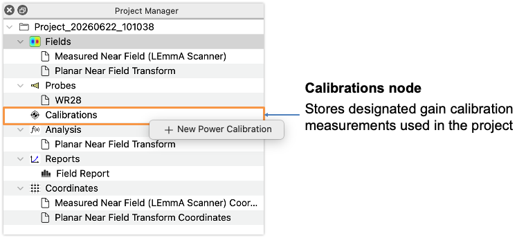
> **Fig. 8:** Calibrations node.

### Analysis Node

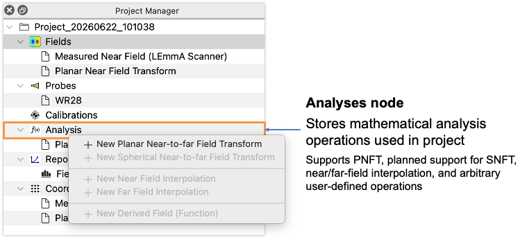
> **Fig. 9:** Analysis node.

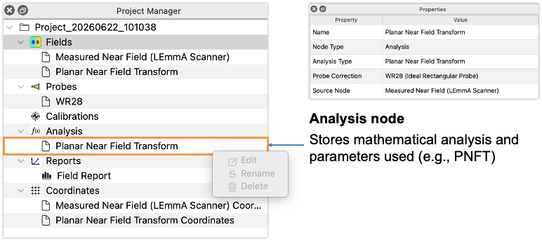
> **Fig. 10:** Analysis: Planar near-field transform node.

### Reports Node

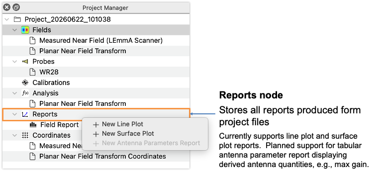
> **Fig. 11:** Reports node.

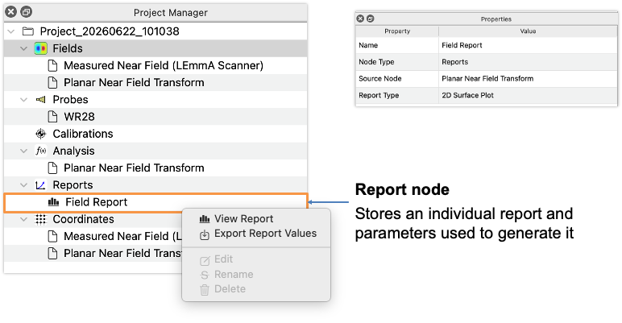
> **Fig. 12:** Report node.

### Coordinates Node

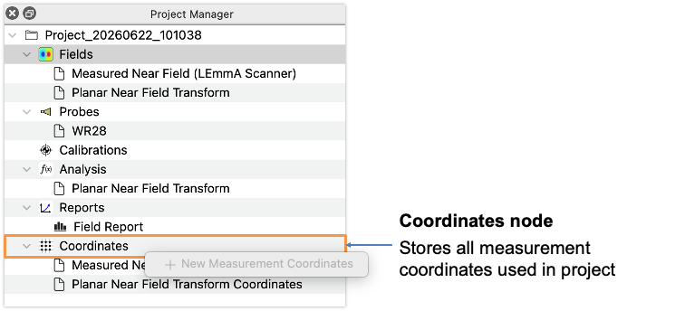
> **Fig. 13:** Coordinates node.

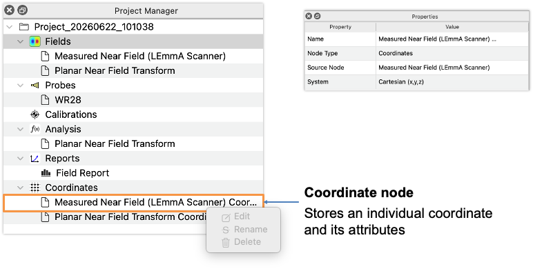
> **Fig. 14:** Coordinate node.

## Report Generation

Reports can be generated for any field by right-clicking on the _Reports Node_.  Available options are _Line Plot_ and _Surface Plot_.

### Line Plot

The _Line Plot_ report window (Fig. 15) allows the user to add and remove traces by interfacing with the "Traces" list on the left side of the MDI window.  To add a new trace, press the <kbd>+</kbd> button; to remove a selected trace, press the <kbd>–</kbd> button.  When adding a new trace, the _New Trace Dialog_ will open, shown in Fig. 16.

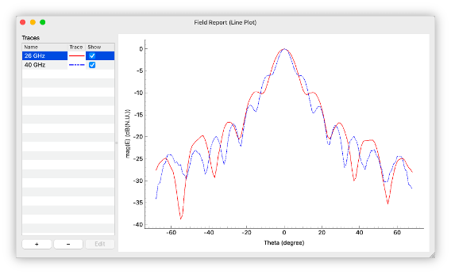
> **Fig. 15:** Line plot displaying the E- and H-Plane cuts of a standard gain horn antenna.

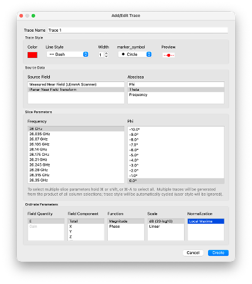
> **Fig. 16:** New Trace dialog for Line Plot.

The _New Trace Dialog_ allows the user to select the trace style and slice through the multi-dimensional data to produce the desired plot.  Data selection and slicing options are:

- **Source Field**: the _Field Node_ desired to be plotted. 
- **Abscissa**: the data to be displayed along the bottom of the plot.
- **Slice Parameters**: these columns will change dynamically based on the selected _Abscissa_, however in all cases the user may select one, or multiple items from the columns.  To select multiple individual items, hold <kbd>ctrl</kbd>/<kbd>⌘</kbd> when selecting, or to select a range hold <kbd>shift</kbd> when selecting. If multiple items are selected, multiple traces will be added to the plot.
- **Ordinate Parameters**: The ordinate parameters displays the field quantity, component, function, scale, and normalization to be applied to the trace.

### Surface Plot

The Surface Plot displays an interactive window which allows the user to quickly view field patterns by frequency. The field quantity, component, plotting domain, function, scale, and normalization may be interactive adjusted as well.

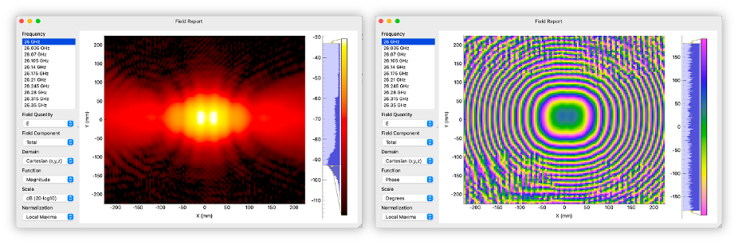
> **Fig. 17:** Surface plot of near-field magnitude (left) and phase (right) for a standard gain horn antenna.

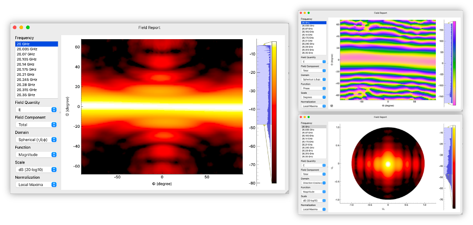
> **Fig. 18:** Surface plot of far-field magnitude (left), phase (upper-right), and magnitude in UV coordinates (lower-right) for a standard gain horn antenna.

### Common Plotting Parameters/Functions

Several common plotting parameters/functions are available in the reporting plots.

- **Field Quantity:** The quantity of the field desired to be plotted:
  - E: The full E-field.
  - rE: The components of the E-field tangential to the spehrical propagation direction.
  - Gain: The calibrated gain value of a field.
- **Component:**: The component of the desired field to be plotted.
- **Domain:** The plotting domain (Surface Plot only), e.g., "spherical", "cartesian", "directional cosine".  Note the "directional cosine" options currently allow projection onto three principle planes: xy, xz, and yz.
- **Function:** The function to apply to the selected data:
  - Magnitude: the modulus of the quantity displayed.
  - Phase: the phase angle of the quantity displayed.
- **Scale:** the scale or units of the quantity displayed, e.g., radians, degrees.
- **Normalization:** the normalization used when displaying the data:
  - Local Maxima: normalize to the maximum value of the currently selected slice of data; i.e., the maximum value of the slice will be 1.0.
  - Gain: for a gain-calibrated measurement, show the absolute gain value.
  - None: do not normalize the data; use the native units of the measurement.

### Report Data Export

Report values may be exported by right-clicking on a _Report Node_ and selecting "Export Report Values".  This will generate a dialog prompting the folder and location and file type for the exported data.  The report will include the view of the data as it is presented in the report, i.e., with all slices and transform operations applied.

The Line Plot export dialog (Fig. 19) displays the export directory and file type options.  The Line Plot will save each trace as a new file inside the directory selected.

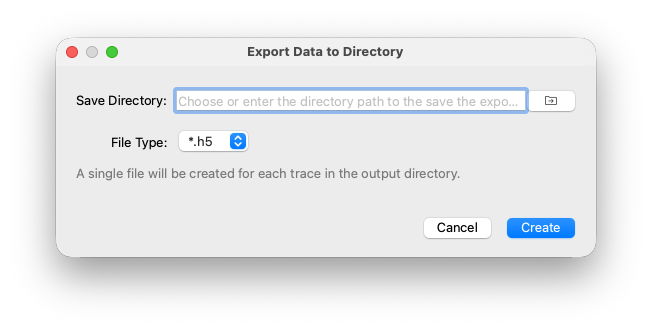
> **Fig. 19**: Line Plot export.

The Surface Plot export dialog (Fig. 20) displays the export directory. The export file type may be selected simply by providing the desired file extension (`.h5` or `.csv`).

> [!NOTE]
> It's _strongly_ encouraged to use HDF5 `.h5` for exporting field data.  Writing fields to CSV `.csv` files can create very large files (100's of megabytes) which are slow to read and write and may result in loss of numerical precision.

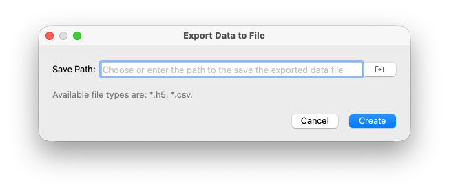
> **Fig. 20**: Surface Plot export.
